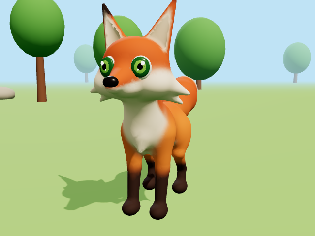
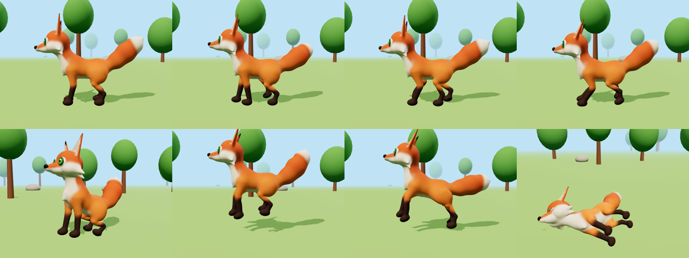

# 🦊 Lisica – animirani 3D lik za igru

Stilizirana crtana lisica (velike oči, velika glava, mekani oblici) s kosturom i
animacijama spremnima za igru.




## Datoteke

| Datoteka | Opis |
|---|---|
| `assets/fox.glb` | Gotov model (glTF 2.0 binary): skinned mesh, kostur, materijali i animacije |
| `index.html` | Preglednik i mala demo igra u three.js |
| `tools/build_fox.py` | Proceduralni generator koji iz koda pravi cijeli model i animacije |

## Model

- **~35 k trokuta** ukupno (tijelo 26 k + oči i nos 8,7 k), ~1,6 MB, prolazi glTF Validator bez grešaka i upozorenja
- Visina ~1 m (s ušima), lisica gleda prema **+Z**, **Y** je gore, tlo je na `y = 0`
- Boje krzna su u vertex bojama (`COLOR_0`) s ugrađenom mekom ambijentalnom okluzijom, pa nisu potrebne teksture
- Oči su slojevite (bjeloočnica, šarenica, zjenica i odsjaj) i imaju vlastite sjajne materijale

### Kostur (32 kosti)

```
root
└─ hips
   ├─ spine ─ chest ─ neck ─ head ─ ear_L / ear_R, eye_L / eye_R
   │          ├─ upperarm_L ─ forearm_L ─ hand_L
   │          └─ upperarm_R ─ forearm_R ─ hand_R
   ├─ thigh_L ─ shin_L ─ foot_L
   ├─ thigh_R ─ shin_R ─ foot_R
   └─ tail1 ─ tail2 ─ tail3 ─ tail4
```

Treptanje i škiljenje rade se skaliranjem kostiju `eye_L` i `eye_R` po osi Y.

### Animacije

| Ime | Trajanje | Petlja | Opis |
|---|---|---|---|
| `Idle` | 4,0 s | da | disanje, pogled okolo, trzanje ušiju, treptanje, mahanje repom |
| `Walk` | 1,0 s | da | hod u četiri takta, šape na tlu (IK) |
| `Run` | 0,5 s | da | galop sa savijanjem kralježnice i ušima unatrag |
| `Jump` | 1,2 s | ne | čučanj, odraz, let, doskok sa „squash" efektom |
| `Attack` | 1,0 s | ne | zalet i udarac šapama |
| `Hit` | 0,55 s | ne | trzaj unatrag, spuštene uši, zažmirene oči |
| `Death` | 1,6 s | ne | pada na bok i zatvara oči |
| `Sit` | 3,0 s | da | sjedi i maše repom |

Sve animacije su „in place“ (igra pomiče lik). Jedino `Jump` sadrži vertikalni
pomak kosti `hips`, a `Death` sadrži rotaciju kosti `root`.
Svaki klip ima ključeve za sve kosti, pa se bez problema miješaju (crossfade).

## Pregled i demo

Pokreni lokalni server (preglednici ne učitavaju `.glb` preko `file://`):

```bash
python3 -m http.server 8000
# otvori http://localhost:8000
```

Kontrole: `WASD` za hod, `Shift` za trk, `Space` za skok, `J` za napad, `C` za sjedenje,
`H` za udarac, `K` za smrt i `R` za oživljavanje. Mišem se okreće kamera, a gumbi
u izborniku pokreću pojedine animacije.

## Uvoz u engine

- **Godot 4**: povuci `fox.glb` u projekt. Animacije su u `AnimationPlayer`. Za petlje uključi *Loop* u Import postavkama.
- **Unity**: s paketom [glTFast](https://github.com/Unity-Technologies/com.unity.cloud.gltfast) ili
  UniGLTF. Drugi način je uvoz u Blender i izvoz u FBX.
- **Unreal 5**: koristi *Interchange* glTF uvoz ili Blender → FBX.
- **three.js / Babylon.js**: učitava se izravno, kao u `index.html`.
- **Blender**: *File → Import → glTF 2.0*. Svaka animacija postaje jedna Action.

## Ponovno generiranje / izmjene

```bash
pip install numpy scikit-image pyfqmr
python3 tools/build_fox.py      # → assets/fox.glb (~30 s)
```

Oblik je složen od SDF primitiva (elipsoidi i zaobljeni stošci) spojenih glatkom
unijom, pa je cijeli lik mekan i zaobljen. Boje, težine za skinning i okluzija
računaju se iz istih dijelova. Proporcije, boje (`ORANGE`, `CREAM` i dr.), boju
očiju (materijali `Iris` i `IrisDark`) te animacije mijenjaš u `tools/build_fox.py`.
Animacije su opisane kao funkcije vremena ili kao ključne poze s IK-om za noge.
